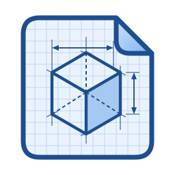

# SCAD Workshop



A desktop app (Windows, Linux) for keeping a library of OpenSCAD projects and making 3D-printable parts from them: add projects from GitHub links, ZIPs and folders (GitHub projects are checked for updates), browse and search everything they make, fill in a model's settings and render it with native OpenSCAD on your computer. The modules of five common OpenSCAD libraries (BOSL2, MCAD, NopSCADlib, Round-Anything, threads-scad) come with the app as ready-to-use **Components**.

**Desktop app:** installers on the [latest release](https://github.com/DrFlGd/SCAD-Workshop/releases/latest) (numbered: 0.4.3, 0.4.4, …; each one built and tested by CI from `main`)
**History:** [CHANGELOG.md](CHANGELOG.md) (what was built, when and why; start there if you're picking up the work)
**Roadmap:** [docs/DESKTOP_PLAN.md](docs/DESKTOP_PLAN.md)

Formerly Claude Grid Workshop, which began as a website; the repository was renamed SCAD-Workshop on 2026-10-13. Since 0.4.4 (owner's decisions of 2026-10-14) the website is no longer published and the app no longer comes with the Gridfinity, openGrid and other generators that were its first tests: your library starts empty apart from Components, and you add the projects you want. Libraries made by earlier versions keep the projects they already have.

## What is here

| Path | What it holds |
| --- | --- |
| `web/` | The front end (no build step): `app.js` (routing, model pages, forms), `ui/` (sidebar, browser views, inspector, tabs, status bar, palette, quick look, the search index), `lib/` (Preact + htm helpers, a small state store), render worker, three.js preview. `platform-desktop.js` is the app's side of the seam (`platform.js` still has the website's). |
| `desktop/` | The desktop app: `core/` (Rust: project reading, the library, native renders, cache, the app's commands, `workshop-cli`) and `src-tauri/` (window, dialogs, `library://`). |
| `libraries.json` | The OpenSCAD libraries the app ships for Components, pinned by commit and content hash (see THIRD_PARTY.md). |
| `engine.json`, `assets/` | Pinned OpenSCAD engines (WebAssembly and native) and checksums; GPL text; bundled fonts. |
| `tools/` | Build (`build_desktop.py`, `build_site.py`, `fetch_engine.py`, `fetch_native_engine.py`, `fetch_libraries.py`, `thumbnails.py`, `set_version.py`), checks (`validate_sources.py`, `parity.py`, `mesh_stats.py`). |
| `tests/` | `desktop_page.py` (acceptance test: the page and the app's backend), `desktop_ui.py` (WebDriver on the built app), `github_mock.py`, `tauri_shim.js`. |
| `vendor/`, `adapters/`, `catalog/`, `libraries/`, `sources/`, `schema/` | **Test projects** (below): the generators and parts packs from the website era, vendored unmodified and hash-checked. CI builds them into a starter library that the tests use; the app doesn't ship it. |

## Test projects

These were the website's catalog and the app's starter library until 0.4.3. They stay in the repository as test projects of many shapes (CI renders every model natively on Linux and Windows) until smaller test projects replace them; the licences below are why some of them were never cleared for sharing prints.


| Family | Models | In the browser | License / public use |
| --- | --- | --- | --- |
| Gridfinity Rebuilt | Bin, Baseplate, Vase Bin | ✅ | MIT · ok |
| Gridfinity Extended | Bin, Baseplate, Connector Clips, Drawers, Item Holder, Lid, Sliding Lid, Bin with Removable Walls, Tray, Silverware Holder, Socket Holder, Sieve, Vertical Divider, Chess Set, Glue Stick Holder, Marble Run | ✅ | GPL-3.0 · ok |
| GridFlock | Baseplate | ✅ | MIT / CC-BY-4.0 · ok |
| Gridfinity Rugged Box | Box (12 parts) | ✅ | CC-BY-SA-4.0 + MIT · ok |
| Gridfinity Basket | Basket | ✅ | MIT · ok |
| Cullenect Label | Label | ✅ | MIT · ok |
| Honeycomb Storage Wall | Grid (v2, v2.3) | ✅ | CC-BY-4.0 · ok |
| openGrid | Grid, Snap, Border | ✅ (Connector source missing) | CC-BY-NC-SA-4.0 · review |
| Label Generator for Gridfinity | Bin Label, Storage Box Label (for Pred's bins and boxes) | ✅ | GPL-3.0 · ok |
| Gridfinity Storage Box Label (Kevenaar) | Box Label | ✅ | CC-BY-4.0 · ok |
| Gridfinity Screw Label (Santalla) | Screw Label | ✅ (adapter fixes include paths) | GPL-3.0-or-later · ok |
| Just Fit Base Grid | Skeleton Baseplate (units, cm or inches) | ✅ | Unstated · review |
| Modular Minimalist Kitchen | Scoop Bin | ✅ (about 25 s per render) | Unstated · review |
| Gridfinity Bin for Pred Labels (3DLG) | Bin with snap-in label holder | ✅ (about 11–13 s) | CC-BY-NC-SA · private use |
| Gridfinity Kitchen | Full Cutout Bin, Edge Cutout Bin (12 size presets from the original files), Spacer, Spacer with Walls | ✅ | MIT |
| Gridfinity Anylid | Lid | ✅ | Unstated · review |
| openGrid Shelf | Shelf | ✅ | Unstated · review |
| Underware (Monokini) | 17 channels, labels and textured variants | ✅ 14 in the browser; T, I-bridge and Mitre channels in the desktop app only | Conflict · private use only |
| Multiboard | — | ❌ source needed | — |

GRIPS and GridPlates are intentionally excluded (superseded). Details: [docs/SOURCE_AUDIT.md](docs/SOURCE_AUDIT.md).

## Desktop app

Plan and phases: [docs/DESKTOP_PLAN.md](docs/DESKTOP_PLAN.md). Done so far: the app shell with native rendering (Phase 1), the library-style interface (Phase 1.5), the portable library with projects added from GitHub, ZIPs and folders, update checks and metadata editing (Phase 2), and Components: the modules of BOSL2, MCAD, NopSCADlib, Round-Anything and threads-scad as forms, pinning and the form editor (Phase 3). The model library and file formats (collections, imports, multi-colour 3MF) come next.

```
web/ (shared UI) --platform.js--> platform-desktop.js --Tauri IPC--> desktop/src-tauri (window, dialogs, library://)
                                                                       └─> desktop/core (Rust, no GUI)
                                                                           api.rs: the app's commands; native OpenSCAD,
                                                                           render queue + cache, library folder, project
                                                                           reading, metadata, updates, merging
```

- **Install:** download from the [latest release](https://github.com/DrFlGd/SCAD-Workshop/releases/latest). Windows: the `-setup.exe` (unsigned, so SmartScreen asks once: More info → Run anyway). Linux: the `.deb` (pulls in the OpenGL libraries OpenSCAD needs) or the `.AppImage` (needs `libopengl0 libegl1 libglx0`, present on most desktops).
- **Engine:** the official OpenSCAD snapshot (pinned in `engine.json` → `native`). On Linux the app unpacks OpenSCAD's AppImage on first start (a few seconds, once).
- **Versions:** every release has its own number, shown in Settings → About. The minor number follows the roadmap phase (0.2 is Phase 2) and the last number counts releases within it; each release's notes list the changes since the one before. CI works the number out from the release tags (`tools/set_version.py`) and publishes a release only when every check passed.
- **Library:** everything you add, save or edit lives in one folder, `~/SCAD Workshop` by default (an existing `~/Claude Grid Workshop` folder keeps being used). It's portable: move it, sync it or keep it in git, then use Library settings → Open another library, here or on another computer; Merge combines two libraries. The render cache, preferences and printer profile stay with the app on each computer. Layout: `sources/<project>/` (source.json, metadata.json with your edits, files/<version>/ untouched, derived/ what reading found), `local/` (your own projects, read when they change), `recipes/` (saved settings), `library.json`.
- **Starter library:** none since 0.4.4. Until 0.4.3 the website's generators and parts came as 19 projects copied into your library on first start; a library that has them keeps them as ordinary projects (edit, relicense or remove them). Library settings no longer offers to bring them back.
- **Browsing:** the left menu lists **Parametric Models**, **Components** and the **Parts Library**. The one you're browsing shows its categories in a panel beside the menu (each opening to its projects); the panel scrolls on its own and folds to a thin strip (« / »). In a small window the menu is a drawer and the categories open under each section. Condense shows one tile per project (or category, license…); a project's tile opens its page: details, README, files, versions and updates.
- **Adding projects:** Add a project (at the bottom of the left menu, on Home, and in Library settings) takes a GitHub link (pinned to a commit and downloaded as plain files; branch, tag, commit and subfolder links work), a ZIP, or a folder (copied, or linked if you're still editing it). Tick "library" for code other projects include (BOSL2, say): `include <BOSL2/std.scad>` then resolves to it. The app finds the models (`.scad` files that make something on their own), reads their settings with OpenSCAD (a file whose values are typed into a module call, like `spur_gear(modul=1, tooth_number=30);` or `block(width=2, height=1/3);`, gets those values as settings, with the library's own descriptions and drop-downs where its Customizer has them), picks up the README, license, presets and ready-made model files, and draws thumbnails.
- **Updates:** GitHub projects are checked at most once a day (or from the project's page). A newer version is downloaded and read beside the current one and summarised (commits, models added or removed, settings changed) for you to accept or skip; your edits are kept either way. A GitHub token in Settings raises GitHub's hourly limit.
- **Editing details:** Edit details in the inspector or on a project's page changes the name, description, category, tags, license, authors, origin, notes or your own fields (material, print time…) for one item, several, a folder, a whole project or the library's defaults. Fields start with the value in use and say where it comes from; a value you leave alone keeps following the project, Reset drops one set here, and Ctrl+Z undoes. An item can be listed under another project (its license and credits stay with the project it came from). Your own fields become filters and table columns.
- **Hide, delete, flag:** hide a model, part or project to keep it out of browsing and search ("Show hidden" in the filters brings it back); delete a model or part to leave it out of the library, also when its project updates; flag a model as broken, with a note (it gets a badge and is listed under Needs attention; a failed render offers the flag). Deleted projects go to the library's `trash/` folder, with your own project's files, until you bring them back or empty the trash.
- **Library settings** (left menu): the library folder; projects (edit details, hide, delete); OpenSCAD libraries (which copy is used, component previews); categories (add, rename, remove, moving their items to another); hidden and deleted items to bring back; the trash; library-wide defaults; GitHub updates and token.
- **Components:** the app comes with five OpenSCAD libraries (BOSL2, MCAD, NopSCADlib, Round-Anything, threads-scad; pinned in `libraries.json`, see THIRD_PARTY.md), and their modules are the **Components** section of the left menu, by topic (gears, threads, fasteners, bearings, hinges, shapes…): about 800 forms. Search finds them by name or setting ("bevel gear" → BOSL2 `bevel_gear()`). A component opens with the values of its first doc example (BOSL2) or suggested ones, and every doc example is under "Start from"; settings you leave empty aren't passed, so the module's own default applies; settings whose docs list their values (BOSL2 `spheroid()`'s `style`: "orig", "aligned", "stagger", "octa", "icosa") are drop-downs; and settings that take any OpenSCAD value (`[10, 20, 5]`, `BOTTOM`) are expression fields. Copy code gives the OpenSCAD file. The first render becomes its thumbnail (Library settings can make them all).
- **Code and documents:** the side viewer on the right (Code, README, a PDF, readme.txt: tabs along its edge; open from a model page, the inspector or a project's page). Code shows the model's OpenSCAD files with line numbers, highlighting, Find and Copy. On the model's own page its files can be edited: Generate renders the edited code (settings left at their defaults take the code's values), and Save keeps the edits with the settings as a variant you pick from the same list ("· code edited"), in the library's `recipes/`; the project's files are never changed and no copy of the model appears, so updates arrive as usual. A component shows the file made for its settings and the library file that defines it, opened at the module. A project's README is converted from Markdown to HTML when the project is read and kept in the library (`sources/<project>/docs/`), with its pictures from the project's own files, so it works offline; PDFs (Printables downloads) are kept as they are and shown where the window can (or opened in your PDF viewer); `readme.txt` is shown as text. Links in them open in your browser. The app's libraries (BOSL2, NopSCADlib…) have theirs too, for Components: NopSCADlib's README has a section for every part.
- **Pin as a model:** keeps a component under Parametric Models with your values as its defaults and only the settings you choose shown (`sources/pinned/pins/` in the library).
- **Edit form:** on any model in your library: rename settings, add help, choices, box names, limits, show-when conditions, a printer-profile link and presets, or hide settings. Stored with the item's details (`metadata.json`), in the same shape as a family manifest's `ui` block (Copy as JSON).
- **Your own copy of a library:** add it as a project and tick "library" (a newer BOSL2, say): it's used instead of the app's copy, for Components and for projects that include it. Library settings → OpenSCAD libraries switches back to the app's copy; projects that include it are read again. Projects that include `<BOSL2/...>` and the others work even without adding them.
- **Desktop-only models:** Underware T, I-bridge and Mitre channels, which crash the browser engine, work in the app.
- **Speed:** CI renders every model with default settings on both systems (`bench-native-*.json` on the `desktop-ci-linux` / `desktop-ci-windows` branches). On Linux the 55 test models that also ran on the website take 28 s natively against 188 s in WebAssembly; the slowest browser models gain most (Minimalist Kitchen bin 25 s → 0.1 s, Pred-label bin 11 s → 0.1 s, Underware wood-texture channel 36 s → 4 s).
- **Windows:** native OpenSCAD on Windows is unusually slow with projects split into many `use`d files: Gridfinity Extended models take 10–15 s natively there, against about 1 s in WebAssembly (it isn't antivirus scanning or the library path; parsing the same code as one file takes 0.2 s). So on Windows the app also carries OpenSCAD's WebAssembly engine: the first render of each model runs both, keeps the faster result and remembers the winner (Settings shows the count and can forget it). Heavy geometry such as the Underware channels still goes native.

Build it yourself (needs Rust, Node, Python and on Linux the WebKitGTK development packages; see the Linux job in `.github/workflows/desktop.yml` for the exact list):

```sh
python3 tools/fetch_engine.py --out build/engine
python3 tools/fetch_native_engine.py --out build/desktop/engine --extract build/native
(cd desktop && cargo build --release -p workshop-core)
python3 tools/build_site.py --engine build/engine --out _site --native-engine build/native/squashfs-root/AppRun
python3 tools/thumbnails.py --site _site --native-engine build/native/squashfs-root/AppRun
python3 tools/fetch_libraries.py --out build/desktop/libs   # the bundled OpenSCAD libraries (or --from-git <folder of clones>)
python3 tools/build_desktop.py --site _site --out build/desktop --fetch-fonts   # ui/, site/, starter/, libs/index/
cd desktop && npx @tauri-apps/cli@2 build          # installers in desktop/target/release/bundle/
```

`workshop-cli` runs the app's own code from the command line:

```sh
cli=desktop/target/release/workshop-cli
$cli bench --app-site build/desktop/site --starter build/desktop/starter --engine build/native/squashfs-root   # every model, from the starter library
$cli render --site _site --engine build/native/squashfs-root --model gridfinity-rebuilt/bin --set gridx=3 --out bin.stl
$cli serve --ui build/desktop/ui --app-site build/desktop/site --starter build/desktop/starter \
    --engine build/native/squashfs-root --home /tmp/workshop-home     # the app's page and backend in a browser
$cli components --libs build/desktop/libs --library BOSL2                       # what each module becomes (topic, start values)
$cli components-check --libs build/desktop/libs --app-site build/desktop/site --engine build/native/squashfs-root --library BOSL2
$cli library-call --library ~/"SCAD Workshop" --app-site build/desktop/site --engine build/native/squashfs-root \
    source_add '{"kind": "github", "url": "https://github.com/chrisspen/gears"}'
```

`serve` is for testing: open http://127.0.0.1:8790/ with `tests/tauri_shim.js` loaded (as `tests/desktop_page.py` does) to use the app's page in an ordinary browser.

## Server version (on hold)

The earlier version rendered on a server (Starlette + native OpenSCAD in Docker, with a shared render cache). It's preserved on the `archive/server-v1` branch and can come back as an optional fallback for models too heavy for a browser.

## Licensing

The app's **Licenses & credits** page (in the menu) lists every project's authors, license, status and source, plus the engine, fonts, three.js, Preact and htm. Model pages only credit the author and link there.


No repository-wide license overrides third-party terms. Each `vendor/` project keeps its own notices; see [THIRD_PARTY.md](THIRD_PARTY.md). The OpenSCAD engine is GPL-2.0-or-later (source: https://github.com/openscad/openscad; text in `assets/engine/COPYING`). Original code in `web/`, `tools/`, `adapters/`, `catalog/` and `schema/` is the repository owner's.

Reference: <https://gridfinity.perplexinglabs.com/> (inventory only; no UI code or adapter scripts copied).
